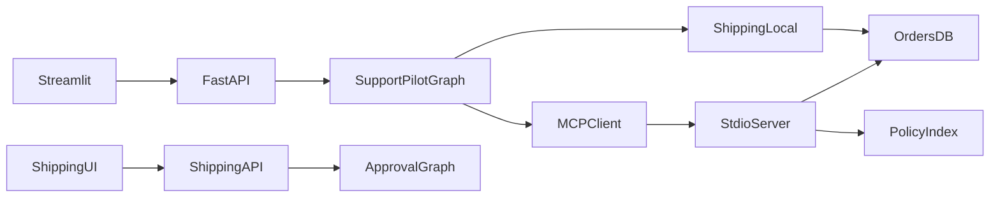

> 历史兼容资料：主要描述原Agent演示。当前新工作台以[作品交付包](portfolio/README.md)、[实际架构](portfolio/architecture.md)和[三段演示](portfolio/demos.md)为准。

# 架构摘要

本文补充[架构与调用链](architecture.md)，供后续开发快速定位。详细节点、MCP 契约和评测口径仍以原文档为准。

CommerceDesk 是面向本地演示的电商客服工作台：政策问答、订单查询、催单与人工审批。订单与政策为演示数据，未接入真实仓库、退款或开票系统。

## 调用链

Streamlit 经 `AgentClient` 调用 FastAPI；聊天图默认经 MCP stdio 使用只读订单与政策工具，催单与审批留在进程内 SQLite。`SUPPORTPILOT_TOOL_BACKEND=local` 可回退进程内只读工具。



网页审批不经过聊天图：`shipping_ui` → `shipping_api` → 独立审批图 `interrupt` / `resume`。客户聊天中的「批准」不能代替审批接口。

## 对话图

```text
START → policy_check → (mode=retrieve 则 tools) → model ⇄ tools → END
```

- `auto` 快捷路径只对独立问候、致谢和明确纯查单省去检查模型，不跳过订单工具。混合问题、更正和复述仍核对证据。
- 证据只认真实 `search_knowledge_base` 工具返回；检查结果允许复用时，模型只能使用指定片段。
- 工具：`get_order_status`、`search_knowledge_base`（只读）；`request_shipping` 始终本地执行。
- `langgraph.json` 与默认 `build_supportpilot_graph()` 使用本地工具，供评测和 LangGraph CLI；API / `run_agent.py` 默认 MCP。

## 数据存储

| 用途 | 位置 |
| --- | --- |
| 对话检查点 | `DATABASE_TYPE`：SQLite `checkpoints.db`、Postgres 或 Mongo |
| 长期 store | 仅 Postgres 有持久 store；SQLite / Mongo 回退内存或 SQLite store |
| 审批检查点 | 订单库旁 `{orders-stem}-approvals.sqlite3` |
| 订单、催单申请、工单 | `data/supportpilot/orders.sqlite3`（`SUPPORTPILOT_DB_PATH`） |
| 政策索引 | `data/supportpilot/chroma/` |

三套库不要混用：聊天线程、审批中断、业务订单各自独立。

## 核心文件

| 文件 | 作用 |
| --- | --- |
| `src/agents/supportpilot_agent.py` | 对话图、证据检查、模型与本地工具 |
| `src/agents/policy_evidence.py` | 真实证据提取、检查校验、窄范围快捷分流 |
| `src/agents/answer_policy.py` | 同一次生成共享的回答与工具边界 |
| `src/agents/mcp_supportpilot.py` | MCP 会话与图生命周期 |
| `src/agents/agents.py` | 仅注册 `supportpilot` |
| `src/business/knowledge.py` | 政策切块、索引与检索入口 |
| `src/business/rag_retrieval.py` | BM25、RRF 融合与重排 |
| `src/business/shipping.py` | 催单校验、审批图和事务执行 |
| `src/business/order_repository.py` | 订单与工单表 |
| `src/business/readonly_tools.py` | MCP 与本地共用的只读响应 |
| `src/tool_protocol/` | 只读 MCP Server 与客户端 |
| `src/service/shipping_api.py` | 审批 HTTP 接口 |
| `src/shipping_ui.py` | 网页审批操作 |

检索默认 `hybrid_rerank`：向量池 + BM25 → RRF → CrossEncoder 重排 → 同源条款补全。入口与参数见[RAG 检索](rag-optimization.md)。

## 配置边界

服务、模型与会话库在 `src/core/settings.py`（`HOST`、`PORT`、`DEFAULT_MODEL`、`DATABASE_TYPE`、`AUTH_SECRET` 等）。

SupportPilot 路径与检索多在 `.env` 的 `SUPPORTPILOT_*`，由业务代码和 MCP 子进程环境读取，未并入 Settings 模型。MCP 子进程转发订单库、索引、检索策略和 Hugging Face 缓存，不转发 LLM 接口密钥。

## 明确不做

- 真实仓配通知、退款执行、开票与优惠券核销
- 多租户与个人账号隔离（`AUTH_SECRET` 为空时 API 无 Bearer 鉴权）
- 远程 HTTP MCP、MCP 认证与租户隔离
- 用聊天消息 resume 加急审批图

## 下一步开发清单

按对本工作台是否阻塞排序。P0 是已写明的产品边界，不是散落的代码 TODO。本清单只记账，不在此次实现。

建议顺序：先处理 P1 回答边界与演示稳定性，再清理 P2 测试、CI 与 toolkit 残留；P0 仅在明确要做真实业务接入时启动。

### P0 — 产品能力缺口

| 项 | 依据 |
| --- | --- |
| 无真实仓库、退款、开票系统；催单工单只写本地 SQLite | [README](../README.md)、[知识库来源](knowledge-sources.md) |
| 无会员、优惠券、发票执行工具；政策只能解释不能办理 | [政策扩充记录](history/2026-10-21-policy-expansion.md) |
| 无预售定金/尾款字段；加急只看已付款与 `promised_ship_at` | 同上 |
| 无多租户；`AUTH_SECRET` 为空则接口不鉴权 | `src/service/service.py` |
| 评测题已用于调参；无独立盲审，无 HTTP / 浏览器 / 并发压测 | [评测总览](evaluation.md) |

### P1 — 客服质量与工程缺口

| 项 | 依据 |
| --- | --- |
| 手机开箱题仍有多余查单邀请；条件政策无证据时的历史失败（`new-name`） | [评测总览](evaluation.md)、回答质量复核 |
| 订单工具没有签收时间、激活状态、实物完好字段，模型仍可能越权承诺 | `src/agents/answer_policy.py` |
| 无 Streamlit / 审批台浏览器回归；演示三条路径靠手工 | [演示流程](demo-and-interview.md) |
| Mongo 长期 store 未实现：`DATABASE_TYPE=mongo` 时检查点走 Mongo，store 仍回退 SQLite / 内存 | `src/memory/__init__.py` |

### P2 — 代码 TODO、未完成与 toolkit 债

| 项 | 位置 |
| --- | --- |
| Mongo store TODO | `src/memory/__init__.py` |
| Deepgram STT、ElevenLabs TTS 未实现（测试故意断言 `NotImplementedError`） | `src/voice/stt.py`、`src/voice/tts.py` |
| Streamlit `st.feedback` 交互测试为空 TODO | `tests/app/test_streamlit_app.py` |
| CI 只跑 unittest 客服集；service / Streamlit / AG-UI / voice 的 pytest 未进工作流 | `.github/workflows/test.yml` |
| 测试与 AG-UI 示例仍引用已删除的 `chatbot`；客户端默认 `agentId=chatbot` | `tests/agents/test_agent_loading.py`、`scripts/agui-client/client.mjs` |
| Streamlit 残留 supervisor / `bg_task_agent` 路径；schema 示例仍写 `research-assistant` | `src/streamlit_app.py`、`src/schema/schema.py` |
| AG-UI 未桥接 `/feedback`、`/history` | [AGUI.md](AGUI.md) |
| `request_shipping` 捕获 `PermissionError`，`submit_shipping` 并不抛出 | `src/agents/supportpilot_agent.py` |
| `pyproject.toml` 残留 duckduckgo、pyowm、langgraph-supervisor 等未使用依赖 | `pyproject.toml` |

### P3 — 可忽略或抽象占位

| 项 | 说明 |
| --- | --- |
| `LazyLoadingAgent.load` 的 `NotImplementedError` | 抽象方法，实现在 `MCPSupportPilotAgent` |
| `tests/core/test_settings.py` 空占位 | 注释标明待删除 |
| 语音除 OpenAI 外未接 | 非本工作台主路径 |
