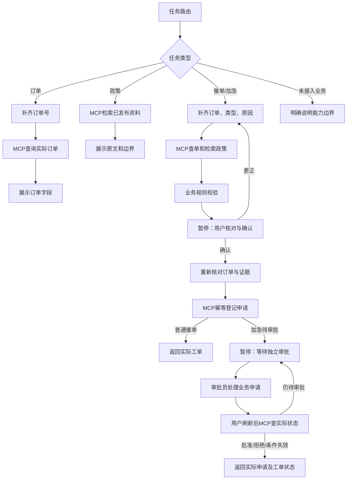

# LangGraph 售后闭环：实现与操作说明

日期：2026-10-28。代码目录：D:\VScodeProgects\commerce-desk-agent。数据库迁移到0003_aftersales。当前版本围绕真实可办理的普通催单/加急申请；退款、退货办理、赔偿和外部仓库通知不在已接入能力内。

## 实际完成的链路



使用真正的StateGraph、interrupt、Command(resume=...)与SQL持久检查点，不用浏览器状态模拟暂停。当前是受约束的业务状态图，并不是任意工具自由循环的通用ReAct，也没有展示或保存模型思维链。其循环主要用于补充、更正和审批跟进。

## 用户操作

1. 客服登录“售后助手”，输入“请帮我催发货”等需求。订单号、申请类型或原因可以先留空。
2. 图会在缺信息时暂停，补充后读取订单并检索政策。系统业务规则检查不通过时直接说明原因，不自动改成别的申请。
3. 确认页展示当前订单、申请类型、原因和将执行的效果。改动输入后，必须先“更新信息并重新核对”，确认按钮才可用。
4. 确认只授权登记本次申请。普通催单返回内部工单；加急进入待审批，不在此时创建加急工单。
5. 审批员用独立账号进入“加急审批”。批准前再次核对订单；已发货、时间缺失等变化可使申请失效。
6. 客服点击“刷新审批结果”，图通过MCP读取业务状态。流程处理结束不等于申请获批；真实申请状态、工单和外部通知分别展示。
7. 刷新浏览器或退出后重新登录，可从“恢复已有流程”选择最近20条自己的流程。已有暂停从MySQL恢复，新的工具凭据由当前会话派生。
8. “停止跟进”只结束图的跟进，不撤销已经提交的业务申请。写入进行中或结果尚不确定时拒绝直接取消，先恢复核实。

本地重启时，正在执行的任务标记interrupted，等待用户恢复；不会在启动时自动重放未知写入。已经等待补充、确认或审批的暂停保留。浏览器断线订阅同一运行，不会新建申请。

## 程序约束

- 既有组织/个人资源隔离继续生效。图的输入、恢复、事件和历史记录均按当前商家及运行所有者校验；审批只看到本商家业务申请。
- 每次恢复必须给出当前pause_id和幂等键。旧确认页不能确认新提案；确认请求不能夹带订单、原因或类型变更。
- 运行状态以短事务和条件更新领取，两个并发确认最多接受一个。写工具使用固定的aftersales:<run-id>业务幂等键。
- 网络调用期间不持有长数据库锁。写入开始前先设置提交围栏，防止用户取消与提交交错而错误显示“没有执行”。
- 业务可能已提交但调用超时：保持明确的不确定提示。显式恢复重试复用同一键，核实既有申请，不自动生成新键重办。
- 用户等待期间，订单字段和引用可能改变。写入前重新查询订单和校验证据；条件不符就不提交。办理后旧引用失效则移除引用并提示，不能因此隐藏已经发生的真实业务状态。
- 工具凭据不进入图状态或检查点。检查点/中间写入与公开消息分开，SSE只发布允许的工具状态、图节点名称、确认内容和最终业务结果。
- 图内部状态单条序列化上限512KB；每流程最多100次显式恢复；补充/更正/确认交互有上限。没有无限自省或自动追加检索循环。
- 没有检索到政策时，不推断未知权益；催单登记仍可依据既有服务端业务规则进行校验，并在确认页明确说明依据。这不构成退货资格、赔偿或分钟级发货承诺。

## 模型接入的准确范围

默认WORKBENCH_AGENT_ROUTER_MODE=rules，不调用大模型。这样本地演示和回归可免费复现。

可选model模式接入显式配置的OpenAI兼容Chat Completions接口，只生成shipping/lookup/knowledge/unsupported四种意图。输出严格校验，最多256输出token，10秒超时，关闭自动重试。每次模型尝试先在SQL预留；若崩溃，恢复不会再付费调用该分类器。失败或格式错误回到明确的规则路由，不授予新增权限。

```text
WORKBENCH_AGENT_ROUTER_MODE=model
WORKBENCH_AGENT_ROUTER_URL=https://<接口地址>/v1/chat/completions
WORKBENCH_AGENT_ROUTER_MODEL=<已确认支持的模型>
WORKBENCH_AGENT_ROUTER_KEY=<仅本机私密配置>
```

只发送用户需求文本，不把完整订单、数据库凭据或检索正文送入该分类器。模型不能选择任意工具参数、审批或跳过确认。真实模型分类效果尚未实测；本轮只通过替身验证接口协议、失败降级与一次调用限制，没有付费调用。用量若缺失保留未知，未配置价格时cost_cny为null，不伪报0元。

没有实现自由自然语言政策答案生成、多步自主工具选择、全局模型费用熔断或完整上下文压缩；不能把此版本宣传成这些能力已完成。

## 数据、模块与API

- aftersales_graph.py：状态图与明确的条件边界。
- aftersales.py：图执行、幂等恢复、提交围栏和公开结果发布。
- checkpoints.py、flow_models.py：MySQL/SQLAlchemy检查点、中间写入、恢复记录。关闭pickle回退，不接受用户上传序列化检查点。
- intent_router.py：可选一次模型意图分类。
- GET /api/v1/aftersales/runs：当前用户最近20条售后流程。
- POST /api/v1/runs：kind=aftersales，query必需，order_number/shipping_kind/reason可补齐。
- POST /api/v1/runs/{id}/resume：action为supply/correct/confirm/refresh/retry/cancel；需要Idempotency-Key。
- 运行详情、取消、SSE继续使用已有接口。新工作台不开放旧invoke/AG-UI入口来读取私人检查点。
- 审批继续复用POST /api/v1/shipping/requests/{id}/decision，未改变既有角色和业务规则。

表wb_graph_checkpoints、wb_graph_writes、wb_flow_actions只用于图持久化；原订单、申请和工单仍是业务事实来源。当前仅支持单API实例、同步检查点和此状态图；没有宣称支持多实例接管、任意子图、分布式worker或通用检查点迁移。

## 复现与测试

```powershell
$env:PYTHONPATH='src'
$env:TEMP='D:\VScodeProgects\commerce-desk-agent\work\temp'
$env:TMP=$env:TEMP
.venv\Scripts\python.exe -m workbench.cli migrate
powershell -File scripts/start-workbench.ps1

# 专用MySQL测试库，不能指向开发业务库。
$env:WORKBENCH_TEST_MYSQL_URL='<commercedesk_test专用连接>'
.venv\Scripts\python.exe -m pytest tests/workbench -q --basetemp=work/temp/aftersales-mysql

# 为重复浏览器验收添加四个明确标记的新演示订单，不覆盖原订单。
.venv\Scripts\python.exe scripts/seed_aftersales_demo.py
npm --prefix frontend run test:e2e
npm --prefix frontend run build
```

统一启动脚本现在把TEMP/TMP、uv缓存和npm缓存指向D盘项目work/目录。浏览器测试继续使用已安装的浏览器，不重复下载C盘组件。验收结束后清理本轮不再使用的测试临时目录，保留测试报告与必要日志。

验收结果见aftersales-checks.json和aftersales-implementation-report.md。未重新运行封存最终题或检索调参实验。Docker/WSL安装和Docker实机验收继续后置。
