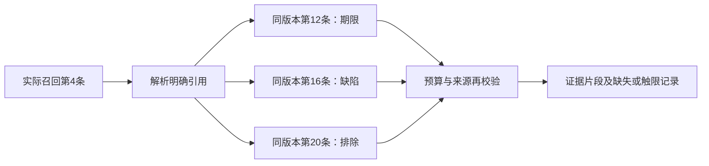

# 长文档、跨条款引用与规模验证

本轮补充原实施路线第3项。输入是合成长文档和相似资料，运行本地向量、BM25、融合与重排，不调用生成模型或付费接口，不扩展售后业务模块。

## 语料和对照

正式数据位于 `data/evaluation/rag_long_scale_v2/`：32道作者开发题、180份合成资料，按12／60／180份嵌套分档。6份长文档每份约1.46万字符，包含相隔多个章节的期限、缺陷、排除条件与引用。其他资料是模板生成的相似商品、期限和操作说明，并含其他商家、过期及撤回版本。

“总文档数量”和“当前商家有效文档数量”分别报告；索引包含全部当前档资料，查询先约束权限和有效性。不能用180份原始资料冒充180份都参与当前商家检索，更不能外推为企业级规模。

6份原始长文中，当前商家有效版本为2份，其余是失效或跨商家控制资料。

首版v1长文超出预定范围，未用于实验；原件保留，见 `rag-long-scale-fixture-note.md`。v2在任何检索评分前准备，标准和评分原文没有根据结果修改。

8种配置比较切块结构／长度、候选池12→24、top3→5、重排开关、用户明确政策版本约束及显式引用扩展。上下文预算2400字符、距离0.65、重排阈值-2。所有题均轮换配置执行顺序；索引逐档增量构建，记录新增索引耗时、模型启动和磁盘占用。性能受本机缓存与并行检查影响，不是线上服务压测。

## 显式引用扩展

`reference_context.py` 解析“参见／另见／详见第N条”，支持阿拉伯数字条号及连续引用。同一组织、同一有效版本的可用片段才可补充，起点必须来自实际检索。最多2跳、8个片段，并遵守总字符预算；循环去重，缺失或受限记入trace。它不理解任意自然语言法律引用，不解析跨文件关系，不证明引用条款适用于当前事实。

MCP服务检索链已接入该模式，生产默认仍为 `neighbors`。显式试用时设置服务端 `WORKBENCH_RETRIEVAL_CONTEXT_MODE=references`，重新启动对应检索服务。Compose同名变量默认仍是neighbors，不由用户对话或模型更改。



没有实际召回入口时不会凭评分清单补出入口；这里只支持明确的阿拉伯数字条号，任意中文数字、无空格标题或跨文件引用仍可能无法解析。

`reference_expansion.complete` 仅表示本次解析范围内引用没有缺失或触限，不能当作政策完整或答案正确。预标注原文全命中时，引用所在章节仍可能有片段未放入预算；两个指标分别记录。

## 指标及人工复核

原始评分衡量当前业务流程绑定的整套条款覆盖，并不等于每道问题的最小证据需求。固定切块可能将一句原文拆开，因此额外保存 `representable_required`，区分索引表示本身不含完整句子和召回漏检。

作者已参与确认两项口径：

1. “上传照片就能自动证明缺陷吗？”可由政策回答，不能作为无证据题；原标签保留，单独重评分。
2. 只问适用范围时，应将范围证据是否足够与整个退货流程所需条款是否齐备分开。

复核文件位于 `data/evaluation/rag_long_scale_review_v1/rubric.json`。最小问题证据重评分只覆盖这5题；其他题的最小证据口径和生成回答正确性未复核。不声称独立盲审，亦不把未生成的回答判定为正确。

## 复现

```powershell
$env:PYTHONUTF8='1'
$env:PYTHONPATH='src'
$env:HF_HUB_OFFLINE='1'
$env:USE_FAKE_MODEL='false'
.venv\Scripts\python.exe scripts/evaluate_rag_long_scale.py validate --output work/rag-long-scale-v1/unused
.venv\Scripts\python.exe scripts/evaluate_rag_long_scale.py run --output work/rag-long-scale-v1/new-run --max-seconds 2400
.venv\Scripts\python.exe scripts/rescore_rag_long_scale.py --input work/rag-long-scale-v1/new-run/traces.jsonl --output work/rag-long-scale-v1/new-review.json
.venv\Scripts\python.exe -m pytest tests/workbench/test_reference_context.py tests/workbench/test_rag_long_scale_cli.py -q
```

输出必须不存在；题号、配置和档位在加载模型及建索引前校验。时间上限在查询间检查，不能中断正在执行的模型／索引操作；触限时保存已完成结果，未完成单元标为未验证，不能混算为失败或成功。不能覆盖首次烟测、主实验或复核结果。

32题×8配置×3档的计划共768条记录。实际完成量、各档结果和边界以 `rag-long-scale-checks.json` 及实验summary为准。没有付费调用，封存最终测试题未读取。

管理员来源选择现支持每页20条和“加载后续政策片段”。跨商家、撤回及版本校验照常执行；能够选择后部原文，不等于管理员映射已经涵盖该长文全部规范条件。
