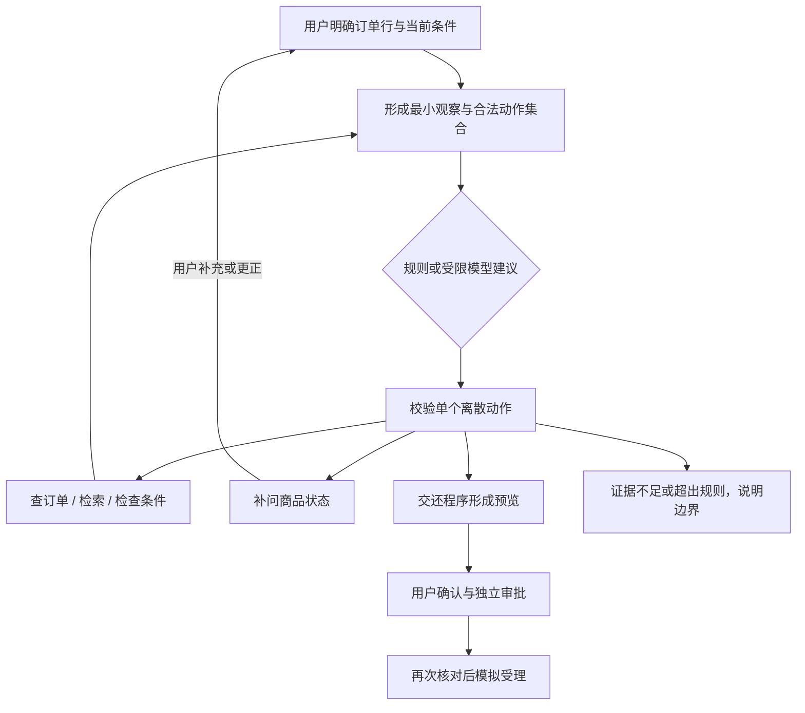

# 受限退货模型决策与政策版本检索

这份说明接续 [退货申请闭环](returns.md)。业务、审批、金额与写入仍由同一领域服务控制；新增的是观察驱动的只读/补问循环，以及可单独比较的政策版本收窄开关。

## 图如何运行



动作只有 `read_order`、`search_policy`、`check_return`、`supplement`、`ask_condition`、`review`、`stop`。模型不能提供工具参数、修改已知条件、决定资格、计算金额、批准或提交申请。`review`只是交还程序生成待确认预览，不等于办理。

合法动作由当前工具观察计算。模型可调整合法读取顺序，后续根据实际返回再提出动作。非法、额外字段、格式异常和不可用结果回退到当前合法规则动作；不会自动修复模型文本或反复请求相同观察。模型自由文本、内部推理不进入公开消息/SSE/历史。

观察仅包括当前结构化条件、必要订单状态、程序检查结果、已校验证据的有界摘录及指纹。历史助手答案不进入依据。用户更正会清除旧观察并重新查事实；更正政策时显式传入新的政策ID，由工具重新验证归属与发布状态。长历史压缩/自然语言自由抽取尚未实现，当前不是通用长期记忆。

## 配置与兼容

默认保持 `return_decisions=rules`、`return_retrieval_mode=baseline`。服务端和管理员配置需同时允许才能调用真实模型：

1. 服务器显式配置 `WORKBENCH_AGENT_ROUTER_MODE=model`、HTTPS模型地址、模型和密钥，同时设置 `WORKBENCH_RETURN_DECISION_MODE=model`。
2. 管理员发布 `model_alias=server_default`、`return_decisions=model` 的配置版本。前端不能设置地址、密钥或绕过服务端开关。
3. 运行创建时固化配置、提示SHA和模型绑定；发布新版本不改变旧运行。关闭服务端模型、变更模板或模型绑定后，旧流程的新请求回退规则。

这些步骤是功能说明，不表示当前演示环境已启用付费调用。[本次数据授权](return-model-data-authorization.md)仅覆盖隔离评测。

新配置采用 `observed_v2`；旧快照缺少这一标记时继续原有图，不偷偷切换检查点节点。旧快照没有新模型提示绑定，也不能自动获得退货模型权限。默认/基线入口和旧图都保留作对照。

每个新退货运行最多6次模型尝试，累计token预留上限仍生效，等待、继续、重启或提高设置不能重置快照中的配额。未知用量保留预留；明确未发送时释放token预留但保留尝试次数。相同观察先保存调用预留；崩溃遗留结果未知时不重放HTTP。租约、账号与登录授权在调用前后检查，迟到结果不能继续推进已停止运行。

HTTP不自动重试；JSON响应体最多64KB，并在读取响应时检查剩余截止时间。供应商单次I/O超时和活跃执行检查共同限制处理，不承诺模型响应延迟。最后的响应读取守卫使用替身补验，没有因该收尾改动追加付费调用。

## 政策收窄开关

`SearchInput.version_id`是进一步收窄条件，不是授权。检索仍检查组织、已发布版本、有效期和返回前发布状态。找不到或版本已失效时不扩大到其他版本兜底。

`policy_scoped`先通过已绑定的退货规则读取并校验当前政策来源，再将版本ID放入知识工具查询。版本来自实际业务绑定，不由模型生成，也不读取评测金标准。默认 `baseline` 保留原查询范围；两种模式都最多补检一次，必要来源仍不足则不提交申请。

规则绑定的原文含义仍依赖管理员人工核对，不能称为自动识别政策适用性。收窄到正确文档也不保证每个条件或例外被正确理解。

## 复现与评测

冻结标准：[return-agent-stage-protocol.md](return-agent-stage-protocol.md)。语料与问题在 `data/evaluation/return_agent_v1/`，与原封存测试题分开。

```powershell
.venv\Scripts\python.exe scripts/evaluate_return_rag.py validate
.venv\Scripts\python.exe scripts/evaluate_return_rag.py run --version all --output work/return-agent-v1/new-rag-run
.venv\Scripts\python.exe scripts/evaluate_return_model.py validate
.venv\Scripts\python.exe -m pytest tests/workbench/test_return_decisions.py tests/workbench/test_return_rag_scope.py -q --basetemp=work/temp/return-agent-tests
```

RAG入口支持题集、版本、基线报告、输出位置和明确题号，非法/重复题号在加载模型或创建索引前拒绝；结果目录不允许覆盖。真实模型脚本只从既有账本预留，最多24次的本阶段上限已用完，不能直接再次运行付费批次。复现实验可以先用模型替身；新增付费批次另行确认，不重置账本。

结果见 [实施与实验报告](return-agent-implementation-report.md)。当前模型版本没有证明比规则基线完成任务更好，继续保留实验开关，不能以24个合法动作宣称客服准确率。
