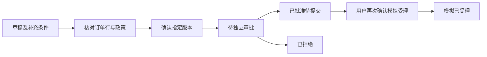

# 订单行级退货申请：业务与 Agent 第一条纵向链路

日期：2026-10-29。代码目录：`D:\VScodeProgects\commerce-desk-agent`。

本文保留首版业务闭环说明。后续可选的受限模型读/问循环与政策收窄见 [return-agent.md](return-agent.md)，真实对照见 [实施报告](return-agent-implementation-report.md)。旧快照仍可使用本文的原图，默认模型关闭。

本阶段把业务从催单/加急扩展到订单行级退货申请。外部受理为**本地模拟**，不会退款、调用真实平台或通知仓库。规则是管理员核对后的演示商家规则，不是对法律或所有商品权益的自动判断。

## 业务链路



草稿可更正，每次递增 revision；旧预览不能确认新内容。确认后内容冻结，需要更改时先取消再申请。草稿、待审批和已批准未受理的申请可取消；已模拟受理的申请不能假装撤销。停止 Agent 跟进不等于取消业务申请。

订单写路径统一先锁订单，再锁申请和政策文档。待审批、已批准和已模拟受理的数量均占用订单行可申请量；确认时在锁内重新计算，不能通过两份并发申请超量办理。取消或拒绝释放占用。当前一份申请对应一个订单行，尚无多行申请合并。

商品金额参考值由整数分单价乘数量计算；它不包含实付优惠分摊、运费和税费，因此 `refund_amount_cents=null`，不能对外承诺退款金额。

## 政策与 RAG 的明确边界

管理员先上传并发布 `returns` 范围的政策，再登记不可变的规则映射：适用 SKU 白名单、实际签收后的时间窗口、是否要求未使用，以及适用对象/期限/状态三类原文来源。每个 quote 必须确实出现在本组织同一已发布版本的 chunk 中，登记行为留审计。

来源存在不等于含义正确。天数、SKU 与条件的语义映射仍需管理员核对；本阶段没有自动验证原文与配置含义相等。没有映射的商品不能套用另一商品的时间或使用状态条件，更不能据此拒绝其他可能存在的退货权利。

业务检查使用实际签收字段，未知保持未知，不从 ETA 或聊天文本写入签收事实。商品状态目前是用户明确提供的陈述，不代表质检已完成。超出演示规则的商品、原因和状态需要人工处理。

Agent 使用真实知识检索，按三类必要来源 ID 记录覆盖。首轮不足时按登记的必要条款至多补检一次；仍不足则结束并明确未提交申请。额外检索能否改善自然语言检索质量尚未通过独立实验验证。程序约束与替身测试不能充当语义正确率。

## LangGraph 与 MCP

退货沿用 `kind=aftersales` 的运行、队列、检查点、SSE 和恢复机制，通过 `return_policy_id` 选择退货图，保留原催单图。补充参数为 `return_item_id`、`return_quantity`、`return_condition` 及原有订单号/原因。

图依次读取订单、检索、检查条件，再根据工具观察进入补问、结束或确认。用户更正后重新读取和检查；确认、独立审批及模拟受理前再次核对。模型接口没有参与本退货图的动作决策，不将此版本称为已完成多轮模型 ReAct。

新增 MCP 工具：`evaluate_return`、`create_return_draft`、`confirm_return_application`、`get_return_status`、`submit_simulated_return`。写工具只对客服授权；没有审批工具，审批仍走独立审批员 API。输入拒绝额外字段，数量使用严格整数。网关核对返回申请身份及关键输入，公开结果明确 `external_mode=simulation`、`actual_refund_executed=false`。

草稿使用固定 `aftersales:<run_id>` 幂等键。模拟受理回执和业务状态在同一数据库事务保存；响应丢失后可以独立查询业务状态，再恢复相同动作，不创建第二次受理。该证明仅针对本地事务模拟适配器，真实外部系统还需其幂等键、结果查询与待核实协议。

## 主要 API

| API | 用途 |
| --- | --- |
| `POST /api/v1/returns/policies` | 管理员登记人工核对规则 |
| `GET /api/v1/returns/policies` | 查询当前可用规则 |
| `GET /api/v1/returns/policy-sources/{version_id}` | 管理员选择已发布政策来源，最多20片段 |
| `POST /api/v1/returns/evaluate` | 只读检查资格、缺失字段与证据 |
| `POST /api/v1/returns/requests` | 幂等保存草稿，必须有 Idempotency-Key |
| `GET /api/v1/returns/requests/{id}` | 查询申请、事件和模拟回执 |
| `GET /api/v1/returns/requests/{id}/preview` | 生成绑定事实与来源的预览哈希 |
| `POST /api/v1/returns/requests/{id}/correct` | 更正草稿并递增版本 |
| `POST /api/v1/returns/requests/{id}/confirm` | 客服确认指定版本与预览 |
| `POST /api/v1/returns/requests/{id}/decision` | 独立审批员批准或拒绝 |
| `POST /api/v1/returns/requests/{id}/submit-simulated` | 客服提交已批准版本的模拟受理 |
| `POST /api/v1/returns/requests/{id}/cancel` | 取消尚未受理的申请 |

客服只看自己的申请；管理员和审批员可看本组织申请，跨组织不可读。已过期/撤回政策不允许继续确认、批准或提交，但已发生业务状态仍可查询。

## 本地演示与复现

数据库新增迁移 `0007_return_applications`，新增规则、申请和事件三张表。更新旧主机服务前先迁移；容器 API 入口会运行增量迁移。不要运行 downgrade 或删除数据卷。

`scripts/seed_return_demo.py` 为每次验收新增独立演示订单和政策，包含正常、缺签收及过期三种订单。它经过真实入库 worker 和索引，再发布文档与登记明确编写的演示规则，不修改已有订单。生产环境禁用该脚本。元数据位于被忽略的 `work/returns-v1/demo.json`。

工作台“退货申请”提供业务表单、原文核对、Agent 工具步骤、补问、更正、暂停恢复、审批和模拟受理。管理员规则面板以原文选择和人工确认登记，不提供任意 SQL 或模型权限配置。

验证命令：

```powershell
.venv\Scripts\python.exe -m pytest tests/workbench/test_returns.py tests/workbench/test_return_graph.py -q --basetemp=work/temp/returns-local
npm --prefix frontend run build
scripts\run-container-acceptance.ps1 -Phase Build
scripts\run-container-acceptance.ps1 -Phase Start
scripts\run-container-acceptance.ps1 -Phase Test
```

MySQL 测试仅设置既有专用 `commercedesk_test*` 数据库连接；测试夹具会清理该测试库，不得指向业务库。真实容器验收使用独立演示数据；测试不会调用付费模型。

## 下一步投入

围绕退货业务增加**受限模型决策**，让模型基于真实观察提出下一次只读查询或补问，并与当前确定性图对照；业务金额、资格、审批、确认和写入权限仍由代码控制。同步建设范围冲突、条件例外、更正和无依据的开发用 RAG 场景，冻结后评估任务完成、错误和误拒答。不优先新增后台框架、通用反思回路或部署组件。
