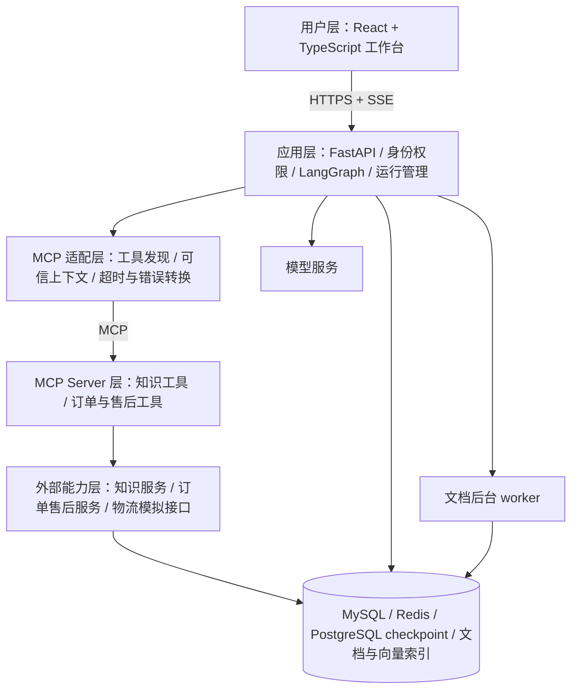

# CommerceDesk：Agent 全栈升级实施路线

状态：方案建议，尚未授权或开始下一阶段代码修改。

编制依据：2026-10-28
本地仓库只读核查、已完成的第一阶段错误诊断、用户提出的全栈与企业工程能力目标。本文替代“下一阶段只做政策筛选”的范围建议；已经完成的诊断与原始记录保留。

## 1. 最终做成什么

将项目定位为“电商售后 Agent 工作台”。知识管理员上传和发布政策，客服围绕订单提问，系统检索依据、查询真实业务字段、补齐缺失信息，生成售后申请；审批员确认后由业务服务提交，客服可以继续查询状态。保留已有普通催单与加急审批。

必须跑通：上传政策 → 解析和索引 → 对话检索 → 订单查询 → 售后申请预览 → 人工审批 → 业务落库 → 状态追踪 → 断线或重启后恢复。

申请、审批和状态记录真实落本项目数据库；物流回调与退款执行先通过明确标记的模拟外部服务演示。有真实平台的开发环境和凭证后再替换适配器。模拟状态不得在界面和报告里写成真实退款、真实仓库操作。

“企业工程能力对标”的验收重点是身份权限、数据隔离、契约、事务、幂等、可恢复、可观测和可部署。它不是已经具备企业生产容量的承诺。

建议总投入约 160—220 小时；每周 20 小时约 8—11 周，学习新栈较多时另留缓冲。若仍要求 4—6 周，就需要更高每周投入，或先完成阶段 0—4 的后端/RAG/业务版本，再完善交互和部署运维。不得把全部范围承诺成低投入的四周任务。

## 2. 已有基础与新增重点

| 方向 | 已经存在 | 本轮升级重点 |
| --- | --- | --- |
| LangGraph | model ↔ ToolNode 的 ReAct 式循环；检查点；审批 interrupt/resume | 业务分流、有界执行、上下文管理、运行恢复 |
| MCP | stdio 持久连接；订单和政策两个只读工具；入参校验 | 服务化连接、身份作用域、写工具授权、错误与幂等契约 |
| RAG | BGE、BM25、RRF、重排、同源条款补全 | 上传解析、版本发布、结构化切块、索引更新、适用范围与覆盖调优 |
| 业务 | SQLite 订单、催单、加急审批与防重复工单 | MySQL 数据层、订单行、售后申请状态机、审批和状态查询 |
| 服务/界面 | FastAPI、Streamlit、SSE、历史、AG-UI | 账号权限、运行 API、React 工作台、重连与文件上传 |
| 部署 | Dockerfile 与 Compose 模板 | 修复电商模块和依赖打包缺口，实际容器和服务器验收 |

核查发现：当前共享 Bearer 与调用者提供的 user_id 不构成真正的账号隔离；历史接口不能仅凭 thread_id 放行。现有服务镜像未完整复制 business/tool_protocol 等电商模块，也未安装 supportpilot extra；不能把“存在 Dockerfile”算作电商链路已经可部署。当前 BM25 在请求中构造全量快照，应改成索引版本级构建与复用。

## 3. 架构与技术栈

采用模块化单体组织应用与业务代码，配独立文档 worker 和 MCP Server 运行边界。五层是职责边界，不要求拆成五套微服务。MCP Server 调用领域服务；领域服务持有权限、状态机和事务规则，禁止模型直接生成 SQL 修改业务。

| 组件 | 默认选择与边界 |
| --- | --- |
| 前端 | React + TypeScript + Vite；仅工作台，不做商城页面 |
| 应用 | 保留 FastAPI、Pydantic、LangGraph、现有模型接入 |
| MySQL | 业务事实、账号、会话目录、公开消息、运行记录、审批、文档版本、幂等记录、审计；SQLAlchemy + Alembic |
| PostgreSQL | 复用现有 LangGraph checkpoint 实现；业务状态以 MySQL 为准，通过稳定 ID 关联，不做双库事务 |
| Redis | 缓存、限流、短期上下文副本、Celery 队列；不能是订单、审批或历史的唯一来源 |
| 文档/向量 | 先使用持久卷保存原文件、保留 Chroma 与 BGE；实测瓶颈后再决定迁移向量库，不同时引入多套 |
| 后台任务 | Celery + Redis；作业状态写 MySQL，重投递靠幂等处理，具备漏任务巡检补偿 |
| 部署 | Docker Compose + Nginx；CI 完成后端、前端和真实链路检查 |

双关系库是兼顾 MySQL 学习目标与已有 checkpoint 的取舍，会增加运维成本。若只追求最少组件，业务也使用 PostgreSQL 更简洁；本方案按用户明确提出的 MySQL 学习目标选择前者，不自研 MySQL checkpoint saver。

模型 API 仍由应用层的模型适配器调用；MCP 负责接入工具和上下文，并不替代模型 API，也不自动提供权限或业务可靠性。

## 4. 阶段总览

| 阶段 | 预计投入 | 主要产物 | 进入下一阶段的门槛 |
| --- | ---: | --- | --- |
| 0. 可维护基线 | 6—8 小时 | 可运行版本、依赖与 CI 清单、初版镜像 | 主路径测试与容器冒烟通过 |
| 1. 后端与数据底座 | 20—28 小时 | 身份权限、MySQL、运行 API、薄前端 | 身份隔离、查单、持久化和 SSE 连通 |
| 2. MCP 工具边界 | 16—22 小时 | 统一工具契约、HTTP 服务接入、审计 | 参数错误和越权被服务端拒绝；故障有明确状态 |
| 3. 文档与 RAG 产品化 | 32—44 小时 | 上传发布链路、检索调优与实验报告 | 来源可定位，旧版失效，效果/退化可比较 |
| 4. 售后 Agent 闭环 | 28—38 小时 | 业务状态机、受限 ReAct、审批执行 | 一条完整售后申请可办理、可恢复、不可重复 |
| 5. 运行可靠性 | 20—28 小时 | 上下文预算、重试降级、恢复与观测 | 故障演练通过；真实状态不丢、不谎报 |
| 6. 前端工作台完善 | 20—28 小时 | 对话、上传、工具步骤、审批、配置 | 浏览器完成全部链路与断线恢复 |
| 7. 部署和作品交付 | 16—24 小时 | Linux 部署、备份演练、验收与演示 | 新环境可复现；服务器与本地实际状态明确 |

这些是工作量估计，不是已测耗时。每阶段交付可演示增量；基础鉴权、幂等和日志必须随功能一起建设，不能全推迟到阶段 5。

## 5. 阶段 0：先形成可维护的升级基线

具体任务：

- 区分原始诊断基线、已保存候选实现、实际开发基线，记录 commit、配置与依赖锁。候选后审继续默认关闭，不能当作已经验证有效的能力。
- 处理 CI 引用缺失测试/模块及已删除示例的问题；确实延期的实验通过独立配置明确隔离，不能只删除失败断言来制造通过。
- 修复镜像内电商代码、依赖、政策演示文件、检索模型缓存和健康检查。模型预热与就绪状态分开。
- 画出数据模型、权限矩阵和业务状态图；明确售后申请与真实退款的边界。

验收：干净环境能安装并运行现有核心服务；容器内能实际完成查单和政策查询；既有催单审批回归通过。交付一份能对应当前版本的运行说明。这个阶段有时间上限，不重写整个项目。

## 6. 阶段 1：后端、账号与数据底座

先建设正常业务 API，后续 Agent 复用，不能先把业务全部埋进 Prompt。

具体任务：

- MySQL 模型包括 organization、user/role、conversation、message、run、run_event、order/order_item、shipment、document/version、ingestion_job、approval、audit。售后表在阶段 4 补齐。组织范围来自已认证身份，不接受模型或请求体冒认。
- 最小支持知识管理员、客服、审批员三类角色与两个演示组织；验证文档、订单、会话、缓存及事件流隔离，不开发 SaaS 套餐和计费。
- 订单事实包含订单行、支付状态、发货状态、实际签收时间及字段来源。未知字段保持为空；演示值必须标记为种子数据，不能把 ETA 自动变成签收时间。
- 建立登录/退出、会话分页、订单查询、运行创建/查询/事件订阅/取消接口。
- 初步 API：`POST /runs`、`GET /runs/{id}`、`GET /runs/{id}/events`、`POST /runs/{id}/cancel`。浏览器断开订阅不重新创建运行；后台执行与订阅解耦，恢复治理在阶段 5 完善。
- 事件至少含 run_id、event_id、type、时间与安全的 payload；身份检查覆盖历史、事件、文件、审批所有入口。
- 以至少一万条种子订单，对最近会话、待审批列表、订单工单历史三类查询保存 EXPLAIN 和索引前后结果；索引按实际过滤/排序字段设计。
- 接上极薄 React 页面：登录、发消息、看步骤和订单字段。现有 Streamlit 保留作开发辅助。

验收：A 组织不能读取 B 的订单、文件、会话或 SSE；客服不能冒充审批员；服务重启后业务和已发布历史仍在；只读查询与 SSE 能在容器内跑通。数据库迁移与备份步骤有记录。

## 7. 阶段 2：MCP 从本地封装升级为工具边界

具体任务：

- 保留 stdio 开发模式，新增用于独立部署的 Streamable HTTP 模式，使用项目所锁 SDK 支持的协议版本，不顺手追全部最新 API。
- 按知识与订单售后划分工具模块，初期可运行在同一 MCP Server；接入方更换地址不改变业务语义。
- 工具契约统一：输入 schema、允许字段、只读/副作用说明、超时、结果 schema，以及 invalid_argument / forbidden / not_found / timeout / unavailable / conflict 等错误。
- 用户与组织作用域由可信后端传递，MCP 服务端再次核对资源归属；工具参数中的“已批准”“管理员”不构成授权。内部服务使用受限凭证和网络边界；公开第三方接入另做完整身份授权设计。
- 查询工具扩展为订单明细、物流事实、政策检索；售后准备/执行接口在阶段 4 随业务加入。约 6—8 个有实际功能的工具足够，不按数量评价进度。
- 工具审计记录 run、调用 ID、操作人、参数摘要、状态、耗时和错误；敏感字段脱敏。
- 暂不把模型直接开放给任意 URL、SQL、Shell 或不限目录的文件操作工具。

验收：错类型、超长输入、错订单、跨组织调用被确定性拒绝；MCP 断开返回明确失败而非伪造业务结果；相同工具在本地和独立进程输出一致。写操作的幂等、审批绑定在阶段 4 验收。

## 8. 阶段 3：把 RAG 做成可管理、可调优的产品能力

### 8.1 文档入库

支持 TXT、Markdown、文本型 PDF、普通 DOCX；扫描件和复杂表格暂不承诺识别，明确返回需 OCR/人工处理。建议初始限制每文件 20 MB、PDF 200 页，配置可调整；解析在独立 worker 中，有时间、资源与失败上限。

流程：上传 → 排队 → 解析 → 分块 → 向量化 → 待发布 → 发布，失败显示具体原因与重试入口。格式核对不能只看扩展名；原文件不作为网页脚本执行。

保留 document_id、version、内容哈希、页码/章节、chunk_id、适用对象、有效期、来源位置。相同内容去重；失败重跑不重复建有效版本。

新版本先完整索引，再切换已发布版本。检索、缓存、下载和引用都按权限与当前有效版本校验；未发布和撤回版本不能继续参与新回答，旧答案可保留历史引用并标注版本。入库任务与索引更新可重入，worker 重启后能续作或安全重跑。

### 8.2 检索调优

- 对照固定长度重叠切块与标题/段落切块；关键条件、例外和表格行不随意拆断，使用父子/邻接片段补充上下文。
- 保留 vector、hybrid、hybrid_rerank 三条现有路径；记录召回池、融合、重排、截断和最终组装分别丢掉哪些必要条款。
- 将 BM25 改成按组织与索引版本构建/复用的快照；更新时原子切换，不再每次请求全量构建。
- 小范围标注商品券/运费券等政策对象、条件和例外。适用性分为适用、不适用、未知；不能靠不确定标签直接删除必要条款。
- 对多意图问题输出子问题与来源覆盖记录；缺证据最多额外补检索一次，仍缺失就只回答有依据部分并说明未知。不得用模型自称“证据齐全”代替来源核验。
- 将第一阶段 018、009、015 作为回归。条件语义保真单独对照：原文条件短引/受约束表达，不把禁用“才/只有”当解决方案。
- 抽取已有候选中可独立验证的证据 ID/版本校验；不整体强推候选后审架构。

验收：建立约 40 条可人工核对必要条款的检索开发问题，包含正常、范围相近、例外、更正、无证据与版本切换；不接触封存的最终测试题。分别报告 Recall@k、必要条款覆盖、不适用证据占比、回答任务完成、语义错误、误拒答、成本与 p50/p95 耗时。

先冻结相同语料与问题上的现有策略对照，一次只改变一个因素。新机制至少改善目标错误或覆盖，正常任务不退化才考虑默认启用；效果不明确就保留对照开关和失败分析，不为取得漂亮分数只挑成功样本。文档入库能力可以独立验收，语义新机制未达标不等于要停掉全部后端建设。

规模目标：至少用 100 份受控演示文档验证完整发布流程，以约一万片段测试索引构建、增量更新和查询成本。合成扩充只用于容量测量，不能充当语义正确性证据。

## 9. 阶段 4：完整售后业务与 LangGraph 调度

### 9.1 先完成确定性的业务

新增售后申请、申请明细、审批记录、状态事件和幂等记录。状态可先限定为：草稿、待审批、已批准待提交、已受理、已拒绝、已取消、已关闭。外部提交不明时使用待核实，不能自动标为失败或成功。

请求中包含订单行、数量、原因和必要材料；数量、资格、权限与状态迁移由领域服务校验。可退金额只由订单事实和明确业务规则计算，模型不计算最终付款金额。缺签收/实物条件时转补充资料或人工判断。

业务 API 先通过集成测试，再封装为 MCP 工具。审批单绑定操作者、申请版本/内容、有效状态；审批后修改参数必须重新审批。执行前重验订单状态，事务与唯一约束保证同一幂等请求只产生一个业务结果。跨 checkpoint 和 MySQL 不做虚构的“恰好一次”：依靠动作 ID、幂等与结果查询恢复。

### 9.2 再让 Agent 调度

| 场景 | 执行方式 |
| --- | --- |
| 独立问候 | 简短回复，不触发政策检索/审查 |
| 明确订单字段查询 | 校验后直接工具查询和字段渲染 |
| 简单政策问题 | 固定 RAG 流程 |
| 订单事实 + 政策判断 + 缺失信息 | LangGraph 中受限 ReAct 循环 |
| 审批、提交、状态迁移 | 确定性业务流程，模型不能跳过 |

图的主线：识别任务 → 查事实/取证 → 列缺失条件 → 用户补齐 → 生成申请预览 → 用户确认 → 等待有权限人员审批 → 执行前重验 → 提交 → 查询状态 → 发布结果。

模型只能提出动作；高风险执行由已授权的图节点触发，经 MCP 调用领域服务。聊天里说“批准”不代替审批 API。记录可核对的操作步骤和依据，不展示或依赖完整内部 CoT。

验收至少包括：正常申请；用户更正订单/券种；缺必要字段；拒绝审批；审批后订单变化；重复点击/回调；提交超时后查到已受理；服务重启后恢复待审批。原有催单/加急流程不能退化。申请创建成功、审批通过、外部已办理是不同状态，界面不得合并。

## 10. 阶段 5：可靠性做到有界、可恢复，再停止无限打磨

具体任务：

- 每次运行配置模型轮数、工具次数、token、费用和总时限。初始建议上限为 6 次模型决策、10 次工具调用、120 秒活跃执行；等待人工审批不占用活跃执行时长。这些是待实测调整的配置，不是延迟承诺。
- 只读瞬时错误有限退避重试；参数、权限和规则错误不自动重试。建议模型最多额外重试 1 次、只读工具最多额外重试 2 次，全部算入上限并记录。
- 写入超时先查动作/幂等结果；不盲目换模型重新执行。失败降级为已取得事实、可操作的下一步或待人工处理，不伪造完整答案。
- 上下文分为可信系统约束、当前已知条件及原话来源、用户更正、待办/审批状态、近期消息、可追溯历史摘要和本轮证据。按实际模型预算预留输出和工具空间，优先移除无关历史和冗长工具正文，完整工具结果外置。
- 不拆断 tool call/result 配对；摘要不把历史助手答案变成政策事实。摘要本身可失真，关键订单 ID、审批绑定与更正使用结构化可信状态保留。
- Redis 丢失后缓存可重建；完整消息与业务记录仍可读取。checkpoint 恢复先核对业务动作结果，防止重放副作用。
- 结构化日志统一 request_id/run_id/tool_call_id，记录步骤耗时、模型/提示词/索引版本、token/费用、失败原因；敏感信息不进入公开事件流。
- 语义后审保留为可选对照，只在已观察到净改善时启用。不能用无限 reflection 回路替代证据、工具契约和业务规则。

验收：故障注入覆盖模型超时、MCP 断开、worker 重启、Redis 清空、浏览器断线、重复提交、长历史和取消运行。机械约束测试要求全部通过；语义能力按冻结场景人工复核，报告残余错误和限制。达到这些门槛后继续产品和部署，不追求宣称零幻觉。

## 11. 阶段 6：完成轻量但完整的 React 工作台

一个对话主页加知识、审批和设置侧栏即可：

- 会话列表、消息、引用展开与定位原文件；区分最终回复、订单事实和业务状态。
- 文件上传、解析/索引进度、失败重试、版本预览与发布；仅有权限的角色能操作。
- 工具步骤卡片显示查询、检索、待补充、待审批、成功/失败；不是显示模型内部思维过程。
- 售后申请预览和审批卡片；客服与审批员权限不同；重复点击可安全处理。
- 模型参数选择与业务提示词配置：模型白名单、温度/输出上限、配置版本。运行开始固定版本；前端不能覆盖权限、工具安全规则或泄露服务端密钥。

通信使用 HTTP 发消息/上传/审批，SSE 接收服务端事件。实现 event_id 去重、心跳、断线续订与过期游标的状态快照恢复。取消表示停止后续动作，已经完成的业务写入仍展示真实状态。

纯安全文本路径可以流式输出；需要先校验的政策回答先显示进度，检查后发布，再逐段呈现。不能为了“打字效果”把会被拦截的草稿提前发送。API、SSE、历史、AG-UI 对公开消息采用一致边界。没有持续双向实时需求时暂不加 WebSocket。

验收：浏览器自动化从登录、上传、提问到申请、审批、查询全部完成；刷新和断线不会重复创建申请或丢失最终结果；被拦截草稿不能从任一公开入口读到。

## 12. 阶段 7：部署、故障演练与作品交付

部署目标为一台 Linux 主机的 Docker Compose：前端/Nginx、API、worker、MCP、MySQL、Redis、checkpoint 与索引服务按需配置；数据不存容器临时层，不公开数据库端口，服务凭证走部署配置。

提供开发/部署配置差异、数据库迁移、检索模型准备、健康与就绪检查、日志查看、回滚与备份恢复文档。先本地完整容器验收，再实际部署服务器；没有服务器/凭证时明确只完成本地容器阶段，不能声称已上线。服务器、域名和新增第三方费用另计，当前计划不授权购买。

测试分开：真实模型小批次用于语义与真实链路；模拟模型压力用于接口、事件与数据库容量。报告机器配置、数据规模、并发数、成功率、队列等待、首事件/首字/总耗时、检索与工具 p50/p95；不能拿模拟模型吞吐宣称真实 Agent 吞吐。

建议先验证 10 个并发会话、2 个并发文档任务在资源限制下可排队、可终止、无越权和重复副作用，延迟目标在首批实测后冻结。至少演练一次备份恢复、MCP 中断恢复和重复提交。

最终交付：架构图、数据模型/索引分析、API/工具契约、RAG 调优报告、Agent 轨迹、故障演练报告、部署手册、演示视频、面试讲解。说明项目来自现有 toolkit 的继承部分与自己新增的业务/工程贡献。

## 13. 可靠性、评测与费用控制

- 第一阶段诊断已完成：34 份完整回答、2 次失败；预算占用上界 4.519364 元，包含未知调用预留，并非供应商账单。
- 原 100 元模型评测总预算继续有效。新阶段建议预分配：RAG 15 元、Agent 15 元、可靠性 15 元、最终验收 20 元；约 30.48 元留作风险与调整余量。任何预算余额都不构成自动付费授权。
- 调用前预留、后结算，未知不按零；日常测试使用可追踪替身，少量真实调用验证模型/MCP兼容。上线后的日常模型使用费和服务器费用不默认为这 100 元已经覆盖。
- 保留原 24 条最终测试题封存；不为了新规划读取它们。新业务用例另建开发与验收集合，按任务家族隔离，候选冻结后再评估。
- 每项机制都保留正常任务对照，不把新增拒答当净改善。任务完成、关键错误、证据覆盖、引用有效性、错误业务动作、成本和延迟同时报告。
- 人工核对关键和争议案例，称“作者参与的复核”。不把小样本结果外推成线上客服准确率，不宣称独立盲审。

## 14. 增量发布与后续扩展

阶段 0—2 结束：V0.2，具有身份、数据层、MCP 工具边界的后端版本。

阶段 3—4 结束：V0.3，上传知识库到售后申请审批的端到端版本，已有薄前端。

阶段 5—7 结束：V1.0，具备完整工作台、可恢复运行、容器/服务器验证与实验报告的作品版本。

V1.0 后按价值扩展：真实平台订单连接器 → 真实物流轨迹/异常工单 → 售后附件 OCR → 工单分类与质检分析 → 商品知识与库存工具。它们复用已有权限、MCP、任务与观测边界。

初版暂缓：完整购物商城、营销推荐、全自动退款、供应链平台、微服务集群、Kubernetes、为了展示而引入的多 Agent 协作和反思回路。若已有能力足以完成任务，优先交付与验证，而非继续增加框架层数。

## 15. 现在开始时的明确顺序

第一次实施只做阶段 0 和阶段 1 的第一小步：冻结可运行基线，修复实际 Docker/CI 缺口，确认订单/申请状态模型，建立 MySQL 与身份权限。随后验收独立业务 API，再推进 MCP 和 RAG。

方案文件的保存不等于代码实施授权。本文没有修改项目、运行付费评测或执行提交/推送；用户明确指令实施后才开始下一阶段。

## 官方资料核对

- [LangGraph：工作流与 Agent](https://docs.langchain.com/oss/python/langgraph/workflows-agents)：固定路径与动态工具循环的区别。
- [LangGraph：持久化](https://docs.langchain.com/oss/python/langgraph/persistence)：checkpoint 与跨线程 store 的职责。
- [LangGraph：中断与恢复](https://docs.langchain.com/oss/python/langgraph/interrupts)：恢复会重入中断节点，业务副作用仍需幂等控制。具体 API 以本项目锁定版本为准。
- [MCP 架构](https://modelcontextprotocol.io/docs/learn/architecture)：Host/Client/Server 职责、stdio 与 Streamable HTTP。
- [Shopify：退货应用](https://shopify.dev/docs/apps/build/orders-fulfillment/returns-apps)：资格判断、申请、审批、跟踪与后续处理是实际平台上的连续业务。本方案借鉴范围，不承诺已接入 Shopify。
- [MDN：SSE](https://developer.mozilla.org/en-US/docs/Web/API/Server-sent_events/Using_server-sent_events)：服务端事件、事件 ID 和重连机制。
- [Docker：Compose 部署](https://docs.docker.com/compose/how-tos/production/)：单机部署与部署配置差异。
