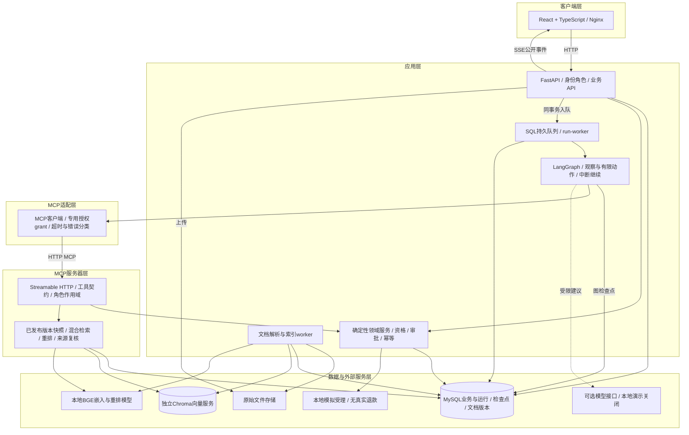

# 当前架构与关键取舍

以下对应新React工作台；原Streamlit/stdio/SQLite入口为历史兼容演示，不能混作同一个运行拓扑。

MCP是应用与工具的协议边界，不是接上协议就获得真实电商平台能力。当前外部订单、质检和受理都使用隔离演示数据；独立审批通过业务API完成，模型不能审批。

## 一次退货的两个状态维度

运行状态描述Agent在做什么：queued/running、awaiting_input、awaiting_confirmation、awaiting_approval、completed/interrupted等。业务申请状态描述单据：draft、pending_approval、approved/rejected、accepted_simulated等。停止跟进不等于撤销已经写入的申请，运行完成也不等于真实退款。

典型链路为：读取订单→检查当前规则及所需实际字段→检索政策→合法补查或补问→用户确认预览→创建申请并提交审批→独立审批→刷新并再次确认→模拟受理。质量分支可在缺乏独立缺陷判定时暂停等待；用户更正分支或条件后重新取证并核对，旧确认不直接沿用。

## 每种技术承担的职责

|技术|实际职责|边界|
|---|---|---|
|React/TypeScript、SSE|对话、上传、工具步骤、继续处理、配置与会话恢复|不是复杂电商业务前台；没有WebSocket必要性|
|FastAPI、Pydantic|角色/组织鉴权、严格入参、领域API|请求不能自带组织/审批人冒认身份|
|LangGraph|显式状态、观察、合法动作、中断/恢复|不是让模型任意组装工具参数；公开动作不等于展示思维链|
|HTTP MCP|有限作用域工具、输入契约、实际返回|第一方授权grant，不宣称完整第三方OAuth平台|
|MySQL、Alembic|订单与单据、角色、版本、队列、检查点、消息、幂等与审计|当前0009、34表；单执行worker为主，没有生产多副本保证|
|Chroma、BGE、BM25、RRF、重排|语义/词项召回、融合、精排及上下文选择|SQL决定发布与权限，向量库不是业务真相|
|Docker Compose|本地7服务交付、日志、独立恢复副本|没有Linux服务器部署、HTTPS或生产容量验证|

没有Redis：当前持久任务、短期流程状态与检查点已经由SQL承担；不能在简历中写Redis长期记忆。没有通用历史摘要/语义长期记忆；历史助手回复不自动变成政策证据。

## 三个设计判断

**什么时候用Agent？** 单纯规则问题走政策检索，无需订单与办理状态；当前入口返回可核对的原文，不能描述成默认模型生成并语义后审。多轮退货涉及未知状态、质检等待、更正和审批，才使用可恢复流程。确定动作直接执行规则路径，模型仅能在允许动作集合中建议，受预算和回退限制。

**RAG为什么不只调top_k？** 先确认必要条款是否进入候选，再区分版本范围、无关分支、条件理解和事实缺失。长文显式引用补全能改善部分办理条款覆盖，却可能增加另一分支内容；因此保留实验开关，并区分规则问答与办理的证据组装。证据存在不代表语义正确。

**为什么约束写操作？** 资格、实际金额、独立审批与写入由领域代码控制，继续处理携带暂停ID和幂等键。只读工具可有限重试，写结果不确定时先查询真实状态，不盲目重放。检查点持久化不被包装为跨库事务。

相关源码：[退货领域](../../src/workbench/returns.py)、[观察图](../../src/workbench/return_observation_graph.py)、[工具契约](../../src/workbench/tool_contracts.py)、[检索](../../src/workbench/retrieval.py)、[证据组装](../../src/workbench/return_context.py)、[执行队列](../../src/workbench/run_worker.py)。
