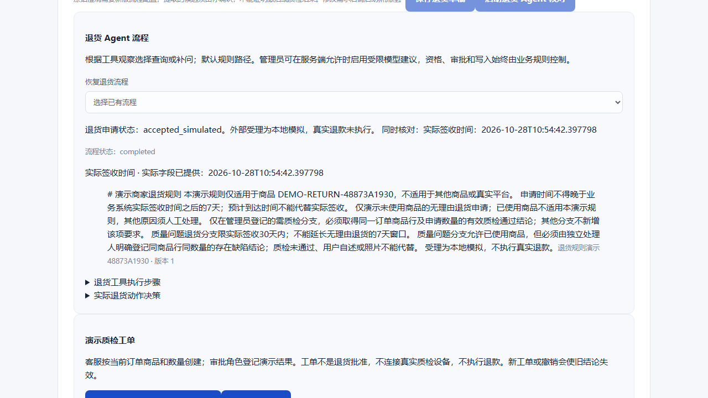
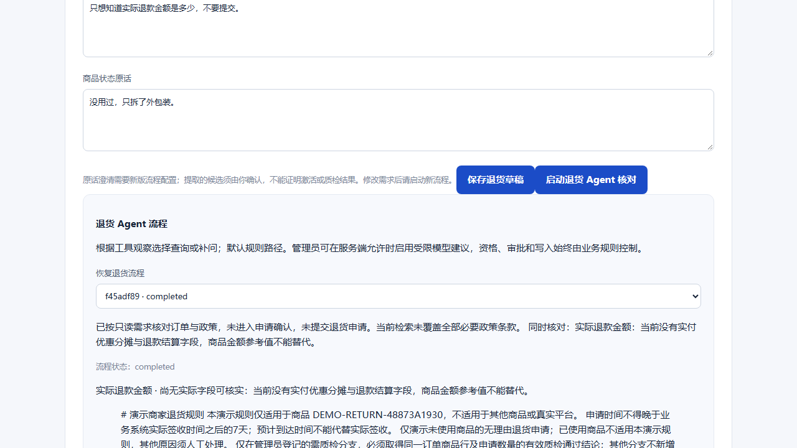
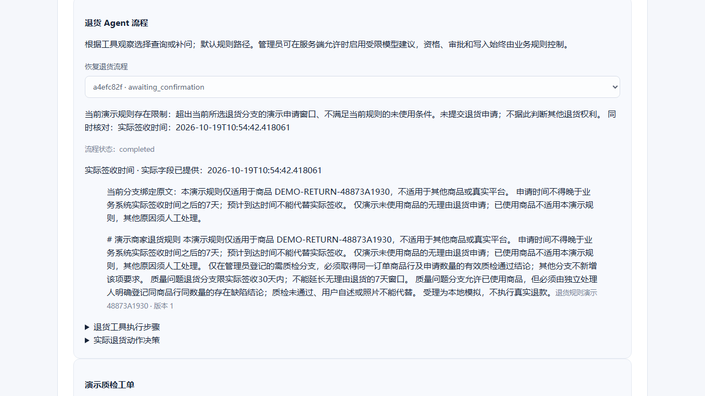

# 本轮三段演示结束画面

2026-10-29，使用新建DEMO订单和政策，服务端模型关闭。三条已有浏览器场景均通过，0自动重试；截图由助手逐张检查后选择，不含登录页或认证内容，不是独立人工盲审。

完整步骤见 [演示脚本](../demos.md)，机器结果见 [demo-results.json](demo-results.json)。截图仅展示结束状态，不能代替过程断言或被称为整段录像。

## 正常办理

同一流程完成审批和本地模拟受理，显示真实退款未执行；当前截图为运行结果区域。

## 事实不足

实际退款字段未提供时明确说明，未进入申请确认。这张结束画面来自同一案例的补拍复验，不能重复算作独立样本。

## 更正后重新核对

已使用、签收约10天的商品切回无理由分支后，不满足当前规则；不会沿用质量分支的30天条件。下拉列表可能保留先前加载的状态，应以当前流程详情为准；该显示局限保留说明。
