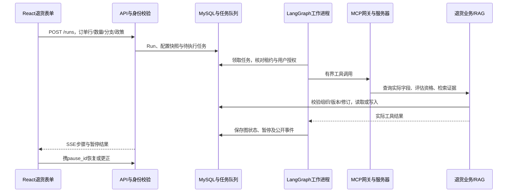

# 从你亲自跑通的退货流程走读源码

先读一次完整请求，再读中断与更正，最后读证据和工具边界。每轮能用自己的话解释一个问题，再开始改代码。当前配置默认规则路径，存在LangGraph不代表每一步都调用模型。

## 第一轮：一次点击为什么没有立即创建申请

从[Returns.tsx](../../frontend/src/Returns.tsx#L50)的`startFlow`读起。它发送`kind=aftersales`、订单、商品行、政策、数量、商品状态、`return_basis`和原因，并生成幂等键，然后订阅该run。你之前选了质量政策却保留默认无理由分支，就是两个独立字段不一致；不是模型替你选了错误政策。

接着读[app.py](../../src/workbench/app.py#L497)的`POST /runs`、[runs.py](../../src/workbench/runs.py#L55)和[run_worker.py](../../src/workbench/run_worker.py#L23)。API先从登录凭证确定用户及组织，保存输入和配置快照，在同一业务流程内排队；不能信任前端传来的角色或组织。工作进程领取任务后执行图。`202`表示已接收任务，不代表申请获批。

读[aftersales.py](../../src/workbench/aftersales.py#L147)：它从run快照恢复有效配置，调用工具前核对运行状态、用户、组织与执行租约，并记录`tool.started`。保存Run只是保存执行过程；创建ReturnRequest是独立业务动作。

练习：不运行任何写操作，在代码中找出“流程ID”和“退货申请ID”分别从哪里产生。解释你那次质量流程已有ID却申请数仍为0的原因。

## 第二轮：为什么等待质检，刷新后又出现预览

读[return_observations.py](../../src/workbench/return_observations.py#L6)的合法动作，再读[return_observation_graph.py](../../src/workbench/return_observation_graph.py)的`gather/decide/check_return/quality_wait/confirmation`相关分支，以及[return_graph.py](../../src/workbench/return_graph.py)复用的确认、审批与模拟受理节点。工具观察决定下一步；有限模型只在明确启用且存在选择时建议动作，不能生成任意工具参数、批准、计算最终退款或登记质检。

以`8936a983`为例：缺少独立缺陷结果时暂停；客服创建质检工单；审批角色登记结论；同商品行/数量/有效修订重新查询后才能预览。客服创建工单不是批准退货，质检未通过也不等于明确存在缺陷。

练习：查找`pause_kind == quality_wait`对应允许的恢复动作。解释为什么这时只能刷新，不能直接提交确认。

## 第三轮：更正为什么不能沿用旧预览

读[Returns.tsx](../../frontend/src/Returns.tsx#L56)的`resumeFlow`与`agentEdits`，再读[aftersales.py](../../src/workbench/aftersales.py#L30)的`continue_flow`。前端负责提示和禁用；服务器还要验证暂停标识、动作、幂等键和当前输入，不能把按钮禁用当安全保证。

读[returns.py](../../src/workbench/returns.py#L136)的`evaluate`、`preview_request`、`check_revision`、`confirm_request`、`decide_request`和`submit_simulated`。政策、实际订单、质检修订和申请内容共同影响预览；确认、审批、受理各阶段重新校验。`8936a983`更正为无理由分支后，7天和未使用条件生效，质量30天及缺陷结论不能继续赋予无理由资格，最终没有新申请。

练习：假设攻击者绕过禁用按钮，把旧pause_id/preview_hash直接发API，指出会在哪些服务器检查处失败。不要实际发送写请求。

## 第四轮：工具、证据、数据库与SSE

|读什么|必须解释的问题|
|---|---|
|[mcp_gateway.py](../../src/workbench/mcp_gateway.py)、[tool_contracts.py](../../src/workbench/tool_contracts.py)|参数、权限、超时、结果校验分别在哪一侧；模型为什么不能任意多传字段|
|[mcp_server.py](../../src/workbench/mcp_server.py)、[returns.py](../../src/workbench/returns.py)|MCP是工具协议边界；真正业务规则仍在领域服务，不能只在提示词限制|
|[retrieval.py](../../src/workbench/retrieval.py)|向量/BM25融合重排、上下文组装后为何再校验SQL发布权限；Chroma有向量不等于可引用|
|[return_context.py](../../src/workbench/return_context.py#L37)|回答一个规则问题所需的证据与办理完整申请所需证据有什么区别|
|[knowledge_service.py](../../src/workbench/knowledge_service.py)、[ingestion.py](../../src/workbench/ingestion.py)|上传原件、内容哈希、异步解析、入库、发布为何分离；重传为何能去重|
|[app.py事件接口](../../src/workbench/app.py#L638)、前端watchRun调用|SSE实时展示的是公开事件，如何按事件ID恢复；页面不能把草稿或未审批状态写成已受理|

面试题：如果只有政策“退款将在收货检测后处理”，为什么不能回答用户银行卡已经到账？答案必须同时说明证据范围和工具实际字段，不只说“为了减少幻觉”。

本轮RAG实验的联系：明确版本可以减少跨渠道干扰，但摘要漏掉软件例外时，向量与引用校验都不能自动补齐语义。实际观察、约束与评测各自负责哪一层，要能分别说明。

完成标准：你能独立讲出上述链路，定位一次状态、更正或证据错误，并提出包含后端验证的最小修改。阅读本文件本身不视为已经完成源码走读或面试演练；后续由你实际解释和修改验证。
